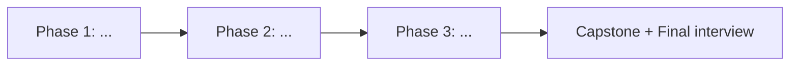

# Lộ trình trở thành <Role>

> Dựa trên: `research/skills-matrix.md` (ngày YYYY-MM-DD) + `learner/profile.md`
> Thời gian học: <n> giờ/tuần · Bắt đầu: YYYY-MM-DD · Dự kiến hoàn thành: YYYY-MM-DD

## Tổng quan

| Phase | Module | Tầng | Cấp độ đích | Giờ ước tính | Tuần | Mốc chứng chỉ |
|---|---|---|---|---|---|---|
| 1 | 01-<skill> | Nền tảng | L3 | 20 | 1–2 | — |
| 1 | 02-<skill> | Cốt lõi | L4 | 30 | 3–5 | <cert-id> |

## Miễn học (dựa trên bài kiểm tra đầu vào)
| Chủ đề | Kết quả kiểm tra | Quyết định |
|---|---|---|

## Phase 1 — <Tên phase>

**Mục tiêu phase**: <sau phase này người học làm được gì>

### Module 01-<skill> — <Tên> (Cấp độ đích: L?)
- **Vì sao cần**: <% tin tuyển dụng, vai trò trong công việc thực tế>
- **Bài học**: xem `modules/01-<skill>/README.md`
- **Bài tập bắt buộc**: ex01 ..., ex02 ...
- **Definition of Done** (đo được):
  - [ ] <vd: Viết Dockerfile multi-stage cho app Node, image < 200MB, chạy non-root, pass check.sh>
  - [ ] Quiz module ≥ 80%

### Cuối Phase 1
- **Mini-project**: <mô tả>
- **Mini interview**: `/phong-van mini 1`

## Mốc chứng chỉ
| Chứng chỉ | Sau module | Dự kiến thi | Chi tiết |
|---|---|---|---|
| <cert-id> | 0X | YYYY-MM | `certifications/<cert-id>/exam-guide.md` |

## Capstone
<Một dự án hoàn chỉnh đưa vào CV, kết hợp mọi kỹ năng Cốt lõi. Mô tả yêu cầu, kiến trúc, tiêu chí đạt.>

## Final
- Full mock interview (`/phong-van full`) — đạt ≥ 75% hai lần liên tiếp = job-ready.

## Lịch sử điều chỉnh
| Ngày | Thay đổi | Lý do |
|---|---|---|
