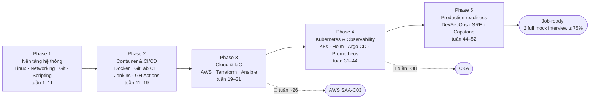

# Lộ trình trở thành DevOps Engineer

> Dựa trên: `research/skills-matrix.md` (ngày 2026-11-05, 72 tin tuyển dụng) + `learner/profile.md`
> Thời gian học: 15 giờ/tuần · Bắt đầu: 2026-11-05 · Dự kiến hoàn thành: 2027-11-03 (tuần 52)
> Mục tiêu: Junior+ → Middle DevOps Engineer, apply được cả thị trường Việt Nam lẫn remote quốc tế

## Tổng quan

| Phase | Module / Mốc | Tầng | Cấp độ đích | Giờ (gốc → có ôn tập) | Tuần | Mốc chứng chỉ |
|---|---|---|---|---|---|---|
| 1 | 01-linux — Linux & quản trị hệ thống | Cốt lõi | L4 | 40 → 48 | 1–4 | — |
| 1 | 02-networking — Networking cho DevOps | Quan trọng → nâng L4 | L4 | 30 → 36 | 4–6 | — |
| 1 | 03-git — Git & quy trình làm việc nhóm | Nền tảng | L3 | 12 → 14 | 6–7 | — |
| 1 | 04-scripting — Scripting: Bash & Python | Cốt lõi | L4 | 40 → 48 | 7–10 | — |
| 1 | **Mini-project Phase 1 + mini interview** | — | — | 10 → 12 | 10–11 | — |
| 2 | 05-docker — Docker & container | Quan trọng → nâng L4 | L4 | 30 → 36 | 11–13 | — |
| 2 | 06-cicd — CI/CD: GitLab CI, Jenkins, GitHub Actions | Cốt lõi | L4 | 40 → 48 | 13–18 | — |
| 2 | **Mini-project Phase 2 + mini interview** | — | — | 12 → 14 | 18–19 | — |
| 3 | 07-aws-foundations — AWS nền tảng | Cốt lõi | L4 | 45 → 54 | 19–22 | — |
| 3 | 08-aws-advanced — AWS nâng cao & kiến trúc | Cốt lõi | L4 | 30 → 36 | 22–25 | → AWS |
| 3 | **Luyện thi AWS SAA-C03 (sau module 08)** | — | — | 22 → 26 | 25–26 | 🎯 thi |
| 3 | 09-terraform — Infrastructure as Code với Terraform | Quan trọng → nâng L4 | L4 | 35 → 42 | 26–29 | (tuỳ chọn) Terraform Associate |
| 3 | 10-ansible — Configuration management với Ansible | Nên biết | L2 | 12 → 14 | 29–30 | — |
| 3 | **Mini-project Phase 3 + mini interview** | — | — | 12 → 14 | 30–31 | — |
| 4 | 11-kubernetes-core — Kubernetes: triển khai ứng dụng | Cốt lõi | L4 | 35 → 42 | 31–34 | — |
| 4 | 12-kubernetes-admin — Kubernetes: quản trị cluster (CKA) | Cốt lõi | L4 | 32 → 38 | 34–36 | → CKA |
| 4 | **Luyện thi CKA (sau module 12)** | — | — | 25 → 30 | 36–38 | 🎯 thi |
| 4 | 13-helm-gitops — Helm & GitOps với Argo CD | Nên biết | L2 | 16 → 19 | 38–40 | — |
| 4 | 14-observability — Monitoring, logging & observability | Cốt lõi | L4 | 40 → 48 | 40–43 | — |
| 4 | **Mini-project Phase 4 + mini interview** | — | — | 12 → 14 | 43–44 | — |
| 5 | 15-security — DevSecOps | Quan trọng | L3 | 20 → 24 | 44–45 | — |
| 5 | 16-sre — SRE: độ tin cậy & vận hành | Nên biết (tăng ở Middle) | L2 | 20 → 24 | 46–47 | — |
| 5 | **Capstone** | — | — | 40 → 48 | 47–50 | — |
| 5 | **Mock interview & chuẩn bị CV** | — | — | 20 → 24 | 50–52 | — |
| | **Tổng** | | | **630 → 756** | **1–52** (tuần 14 nghỉ Tết) | |

**Cách tính giờ**: giờ gốc = bài học + bài tập + quiz; cộng thêm 20% cho ôn tập ngắt quãng. 756 giờ ÷ 15 giờ/tuần ≈ 50.4 tuần học + 1 tuần nghỉ Tết (tuần 14, từ 2027-02-04) → **vừa khít 52 tuần, gần như không có thời gian dự phòng**.

**Nếu bị chậm** (ốm, dự án gấp ở công ty...), có 2 phương án, chọn khi cần:
1. **Tăng lên ~17 giờ/tuần** trong vài tuần để bù.
2. **Thu gọn phạm vi tầng "Nên biết"**: Ansible (10) học 2 bài thay vì 4, Helm/GitOps (13) gộp vào mini-project Phase 4, SRE (16) chỉ làm ex02 → tiết kiệm ~25 giờ (~2 tuần). Terraform Associate (tuỳ chọn) bỏ.

**Không đợi xong mới apply**: từ khoảng **tuần 40** (đã có AWS SAA, CKA, 3 mini-project) bạn có thể bắt đầu apply các vị trí Junior/Junior+ trong khi tiếp tục học Phase 4–5.

## Dự án xuyên suốt: TaskFlow

Một ứng dụng quản lý công việc nhỏ, **gần với thế mạnh frontend của bạn**: Vue 3 SPA + Node.js (Express) API + PostgreSQL + Redis. Mentor cung cấp code app sẵn (bạn không phải viết app); việc của bạn là **vận hành** nó, nâng cấp dần qua từng phase:

| Phiên bản | Phase | TaskFlow chạy ở đâu / thế nào |
|---|---|---|
| v0 | 1 | Một server Linux: systemd + Nginx + TLS, provisioning bằng script, backup cron |
| v1 | 2 | Container hoá toàn bộ, CI/CD tự deploy, rollback, scan bảo mật |
| v2 | 3 | AWS (VPC, ECS/ALB, RDS, CloudFront) dựng 100% bằng Terraform |
| v3 | 4 | Kubernetes (EKS) + Helm + Argo CD + Prometheus/Grafana/logging |
| v4 = Capstone | 5 | Thêm DevSecOps, SLO, DR, tài liệu kiến trúc → đưa vào CV |

## Miễn học (dựa trên bài kiểm tra đầu vào)
| Chủ đề | Kết quả kiểm tra | Quyết định |
|---|---|---|
| Git, HTTP, scripting (có thể đã biết từ 4 năm frontend) | Không kiểm tra — theo yêu cầu của người học ("coi tôi như người chưa biết gì ngoài frontend") | **Không miễn** — học đầy đủ. Mentor sẽ đi nhanh hơn ở phần bạn đã quen nếu bạn trả lời tốt câu kiểm tra cuối bài |

## Phase 1 — Nền tảng hệ thống

**Mục tiêu phase**: Tự tin làm việc trên server Linux, hiểu mạng, dùng Git chuẩn, viết script tự động hoá; chạy được TaskFlow trên 1 server.

### Module 01-linux — Linux & quản trị hệ thống (Cấp độ đích: L4)
- **Vì sao cần**: Linux có trong 68.6% tin J/M (100% bắt buộc khi được nhắc). Mọi server, container, Kubernetes node đều chạy Linux.
- **Bài học** (10 bài): xem `modules/01-linux/README.md`
- **Bài tập bắt buộc**: ex01-server-setup (lab, L2) · ex02-app-as-service (lab, L3) · ex03-broken-server (debug, L3) · ex04-incident-rca (tư duy, L4)
- **Definition of Done** (đo được):
  - [ ] Mọi bài tập bắt buộc ≥ 80/100 + vấn đáp đạt
  - [ ] `check.sh` của ex02 pass: service `taskflow-api` enabled, tự khởi động lại khi bị kill, Nginx trả 200
  - [ ] Giải quyết ex03 trong ≤ 45 phút không cần gợi ý mức 3
  - [ ] Quiz module ≥ 80%

### Module 02-networking — Networking cho DevOps (Cấp độ đích: L4)
- **Vì sao cần**: 51% tin J/M, 61.1% mọi level; nền của VPC, Kubernetes networking và gần như mọi bài debug khi phỏng vấn.
- **Bài học** (8 bài): xem `modules/02-networking/README.md`
- **Bài tập bắt buộc**: ex01-subnet-and-proxy (lab, L2) · ex02-network-debug (debug, L3) · ex03-timeout-investigation (tư duy, L4)
- **Definition of Done** (đo được):
  - [ ] Mọi bài tập bắt buộc ≥ 80/100 + vấn đáp đạt
  - [ ] Chia đúng 10/10 bài subnet trong quiz
  - [ ] ex02: tìm và sửa đủ 3 lỗi, giải thích được bằng chứng của từng lỗi
  - [ ] Quiz module ≥ 80%

### Module 03-git — Git & quy trình làm việc nhóm (Cấp độ đích: L3)
- **Vì sao cần**: Chỉ 25.5% tin ghi rõ vì nhà tuyển dụng mặc định bạn biết; mọi CI/CD, IaC, GitOps đều dựa trên Git.
- **Bài học** (5 bài): xem `modules/03-git/README.md`
- **Bài tập bắt buộc**: ex01-team-workflow (lab, L2) · ex02-git-rescue (debug, L3)
- **Definition of Done** (đo được):
  - [ ] Mọi bài tập bắt buộc ≥ 80/100 + vấn đáp đạt
  - [ ] Repo TaskFlow có ≥ 5 MR đã merge, tag `v0.1.0`, không secret trong lịch sử (gitleaks pass)
  - [ ] Quiz module ≥ 80%

### Module 04-scripting — Scripting: Bash & Python (Cấp độ đích: L4)
- **Vì sao cần**: Nhóm Scripting 76.5% tin J/M (Python 60.8%, Bash 52.9%). Tự động hoá là trái tim của DevOps.
- **Bài học** (10 bài): xem `modules/04-scripting/README.md`
- **Bài tập bắt buộc**: ex01-backup-script (lab, L2) · ex02-healthcheck-cli (lab, L3) · ex03-broken-scripts (debug, L3) · ex04-log-analyzer (project, L4)
- **Definition of Done** (đo được):
  - [ ] Mọi bài tập bắt buộc ≥ 80/100 + vấn đáp đạt
  - [ ] shellcheck không cảnh báo trên mọi script nộp
  - [ ] ex04 có ≥ 5 test pytest pass, xử lý file 100MB < 30 giây
  - [ ] Quiz module ≥ 80%

### Cuối Phase 1
- **Mini-project**: TaskFlow v0 — một server Linux: script provisioning (user, firewall, Nginx + TLS, systemd, backup cron) + runbook vận hành
- **Mini interview**: `/phong-van mini 1`

## Phase 2 — Container & CI/CD

**Mục tiêu phase**: Đóng gói ứng dụng bằng container và tự động hoá toàn bộ đường từ commit tới production.

### Module 05-docker — Docker & container (Cấp độ đích: L4)
- **Vì sao cần**: Container 56.9% tin J/M; tiền đề bắt buộc của Kubernetes và CI/CD hiện đại.
- **Bài học** (10 bài): xem `modules/05-docker/README.md`
- **Bài tập bắt buộc**: ex01-dockerize-taskflow (lab, L2) · ex02-compose-stack (lab, L3) · ex03-broken-containers (debug, L3) · ex04-harden-image (project, L4)
- **Definition of Done** (đo được):
  - [ ] Mọi bài tập bắt buộc ≥ 80/100 + vấn đáp đạt
  - [ ] Image API < 200MB, chạy non-root, build được cả linux/amd64 và linux/arm64
  - [ ] `docker compose up` từ repo sạch → app chạy trong ≤ 2 phút
  - [ ] Quiz module ≥ 80%

### Module 06-cicd — CI/CD: GitLab CI, Jenkins, GitHub Actions (Cấp độ đích: L4)
- **Vì sao cần**: Nhóm CI/CD có tỷ lệ cao nhất: 84.3% tin J/M. GitLab CI 35.3%, Jenkins 33.3%, GitHub Actions 27.5%.
- **Bài học** (10 bài): xem `modules/06-cicd/README.md`
- **Bài tập bắt buộc**: ex01-ci-pipeline (lab, L2) · ex02-cd-with-rollback (lab, L3) · ex03-broken-pipeline (debug, L3) · ex04-port-pipeline (lab, L3) · ex05-pipeline-design (tư duy, L4)
- **Definition of Done** (đo được):
  - [ ] Mọi bài tập bắt buộc ≥ 80/100 + vấn đáp đạt
  - [ ] Pipeline TaskFlow xanh, tổng thời gian < 10 phút, merge vào main tự deploy
  - [ ] Rollback về bản trước trong < 5 phút (đo được)
  - [ ] Quiz module ≥ 80%

### Cuối Phase 2
- **Mini-project**: TaskFlow v1 — container hoá toàn bộ + pipeline CI/CD tự deploy lên server, có rollback và scan bảo mật
- **Mini interview**: `/phong-van mini 2`

## Phase 3 — Cloud AWS & Infrastructure as Code

**Mục tiêu phase**: Thiết kế và dựng hạ tầng AWS hoàn toàn bằng code; đạt chứng chỉ AWS.

### Module 07-aws-foundations — AWS nền tảng (Cấp độ đích: L4)
- **Vì sao cần**: AWS có trong 68.6% tin J/M (75% tin VN) — cloud phổ biến nhất ở cả hai thị trường.
- **Bài học** (10 bài): xem `modules/07-aws-foundations/README.md`
- **Bài tập bắt buộc**: ex01-secure-account (lab, L2) · ex02-three-tier-vpc (lab, L3) · ex03-deploy-taskflow-aws (lab, L3) · ex04-vpc-debug (debug, L4)
- **Definition of Done** (đo được):
  - [ ] Mọi bài tập bắt buộc ≥ 80/100 + vấn đáp đạt
  - [ ] TaskFlow sống sót khi terminate 1 instance (ALB vẫn trả 200)
  - [ ] Dọn sạch tài nguyên sau mỗi lab (kiểm bằng script)
  - [ ] Quiz module ≥ 80%

### Module 08-aws-advanced — AWS nâng cao & kiến trúc (Cấp độ đích: L4)
- **Vì sao cần**: Bổ sung phần kiến trúc, container & serverless mà tin Middle hỏi nhiều; phủ objective còn lại của chứng chỉ AWS.
- **Bài học** (10 bài): xem `modules/08-aws-advanced/README.md`
- **Bài tập bắt buộc**: ex01-ecs-fargate-oidc (lab, L3) · ex02-architecture-doc (tư duy, L4) · ex03-serverless-worker (lab, L2)
- **Definition of Done** (đo được):
  - [ ] Mọi bài tập bắt buộc ≥ 80/100 + vấn đáp đạt
  - [ ] Pipeline deploy ECS không dùng access key dài hạn
  - [ ] Tài liệu kiến trúc được grader chấm ≥ 80 (có trade-off rõ ràng)
  - [ ] Quiz module ≥ 80%

### 🎯 Mốc: thi AWS Certified Solutions Architect – Associate (SAA-C03)
- Luyện thi ~22 giờ (`/luyen-thi aws-saa`): đề thi thử tiếng Anh đúng format 65 câu / 130 phút (+30 phút ESL).
- Điều kiện đi thi: 3 đề thi thử liên tiếp ≥ 85%, không domain nào < 70%.

### Module 09-terraform — Infrastructure as Code với Terraform (Cấp độ đích: L4)
- **Vì sao cần**: IaC 54.9% tin J/M, 63.9% mọi level; Terraform 45.1%, gấp ~5 lần CloudFormation; 61% tin VN.
- **Bài học** (10 bài): xem `modules/09-terraform/README.md`
- **Bài tập bắt buộc**: ex01-first-infra (lab, L2) · ex02-modules-remote-state (lab, L3) · ex03-state-drift-debug (debug, L3) · ex04-terraform-pipeline (project, L4)
- **Definition of Done** (đo được):
  - [ ] Mọi bài tập bắt buộc ≥ 80/100 + vấn đáp đạt
  - [ ] `terraform destroy` rồi `apply` lại → TaskFlow chạy, không thao tác tay trên console
  - [ ] tflint + checkov không lỗi HIGH
  - [ ] Quiz module ≥ 80%

### Module 10-ansible — Configuration management với Ansible (Cấp độ đích: L2)
- **Vì sao cần**: Ansible 15.7% tin J/M, 20.8% mọi level; phổ biến ở công ty có server on-premise (ngân hàng, viễn thông VN).
- **Bài học** (4 bài): xem `modules/10-ansible/README.md`
- **Bài tập bắt buộc**: ex01-ansible-role (lab, L2)
- **Definition of Done** (đo được):
  - [ ] Mọi bài tập bắt buộc ≥ 80/100 + vấn đáp đạt
  - [ ] Chạy playbook 2 lần liên tiếp: lần 2 `changed=0`
  - [ ] Quiz module ≥ 80%

### Cuối Phase 3
- **Mini-project**: TaskFlow v2 — chạy trên AWS 100% bằng Terraform (VPC, ECS/ALB/RDS/CloudFront), pipeline plan/apply, destroy/apply lại được
- **Mini interview**: `/phong-van mini 3`

## Phase 4 — Kubernetes & Observability

**Mục tiêu phase**: Vận hành ứng dụng trên Kubernetes theo GitOps, có giám sát và cảnh báo; đạt CKA.

### Module 11-kubernetes-core — Kubernetes: triển khai ứng dụng (Cấp độ đích: L4)
- **Vì sao cần**: Kubernetes 66.7% tin J/M (80% tin VN); CNCF 2025: 82% tổ chức dùng container chạy Kubernetes ở production.
- **Bài học** (10 bài): xem `modules/11-kubernetes-core/README.md`
- **Bài tập bắt buộc**: ex01-taskflow-on-k8s (lab, L2) · ex02-probes-hpa (lab, L3) · ex03-broken-manifests (debug, L3)
- **Definition of Done** (đo được):
  - [ ] Mọi bài tập bắt buộc ≥ 80/100 + vấn đáp đạt
  - [ ] Rolling update TaskFlow không mất request (đo bằng load test)
  - [ ] ex03: sửa đủ 5 lỗi trong ≤ 40 phút
  - [ ] Quiz module ≥ 80%

### Module 12-kubernetes-admin — Kubernetes: quản trị cluster (CKA) (Cấp độ đích: L4)
- **Vì sao cần**: Phần quản trị cluster là trọng tâm CKA và các câu hỏi phỏng vấn Middle (upgrade, backup, RBAC, troubleshooting).
- **Bài học** (10 bài): xem `modules/12-kubernetes-admin/README.md`
- **Bài tập bắt buộc**: ex01-kubeadm-cluster (lab, L3) · ex02-rbac-netpol (lab, L3) · ex03-broken-cluster (debug, L4) · ex04-eks-terraform (project, L3)
- **Definition of Done** (đo được):
  - [ ] Mọi bài tập bắt buộc ≥ 80/100 + vấn đáp đạt
  - [ ] Restore etcd thành công từ snapshot
  - [ ] Đạt ≥ 85% hai lần trên đề thi thử CKA tự soạn
  - [ ] Quiz module ≥ 80%

### 🎯 Mốc: thi Certified Kubernetes Administrator (CKA)
- Luyện thi ~25 giờ (`/luyen-thi cka`): bài thực hành tốc độ trên cluster thật, 2 lượt killer.sh đi kèm phí thi.
- Điều kiện đi thi: 3 đề thi thử liên tiếp ≥ 85%, không domain nào < 70%.

### Module 13-helm-gitops — Helm & GitOps với Argo CD (Cấp độ đích: L2)
- **Vì sao cần**: GitOps 25.5% (Argo CD 19.6%), Helm 17.6% tin J/M; là cách deploy chuẩn ở công ty dùng Kubernetes trưởng thành.
- **Bài học** (4 bài): xem `modules/13-helm-gitops/README.md`
- **Bài tập bắt buộc**: ex01-helm-argocd (lab, L2)
- **Definition of Done** (đo được):
  - [ ] Mọi bài tập bắt buộc ≥ 80/100 + vấn đáp đạt
  - [ ] Merge MR đổi image tag → Argo CD tự deploy trong ≤ 3 phút, không chạy kubectl tay
  - [ ] Quiz module ≥ 80%

### Module 14-observability — Monitoring, logging & observability (Cấp độ đích: L4)
- **Vì sao cần**: Monitoring/Observability 64.7% tin J/M (Prometheus 39.2%, Grafana 33.3%); Logging 37.3% (ELK 19.6%).
- **Bài học** (10 bài): xem `modules/14-observability/README.md`
- **Bài tập bắt buộc**: ex01-metrics-dashboard (lab, L2) · ex02-alerting (lab, L3) · ex03-logging-stack (lab, L3) · ex04-incident-investigation (tư duy, L4)
- **Definition of Done** (đo được):
  - [ ] Mọi bài tập bắt buộc ≥ 80/100 + vấn đáp đạt
  - [ ] Dashboard có 4 golden signals; alert bắn trong ≤ 2 phút khi lỗi 5xx > 5%
  - [ ] Mọi log của TaskFlow là JSON, tìm được theo request-id
  - [ ] Quiz module ≥ 80%

### Cuối Phase 4
- **Mini-project**: TaskFlow v3 — trên Kubernetes (EKS) bằng Helm + Argo CD, Prometheus/Grafana/logging, alert hoạt động
- **Mini interview**: `/phong-van mini 4`

## Phase 5 — Production readiness & Job-ready

**Mục tiêu phase**: Bảo mật, độ tin cậy, capstone hoàn chỉnh cho CV, phỏng vấn thử tới khi đạt chuẩn job-ready.

### Module 15-security — DevSecOps (Cấp độ đích: L3)
- **Vì sao cần**: Security/DevSecOps 37.3% tin J/M, 44.4% mọi level (IAM, secrets management dẫn đầu).
- **Bài học** (5 bài): xem `modules/15-security/README.md`
- **Bài tập bắt buộc**: ex01-security-gates (lab, L3) · ex02-harden-workload (debug, L3)
- **Definition of Done** (đo được):
  - [ ] Mọi bài tập bắt buộc ≥ 80/100 + vấn đáp đạt
  - [ ] Pipeline chặn merge khi có secret hoặc lỗ hổng CRITICAL
  - [ ] Không còn secret dạng plain text trong repo/manifest
  - [ ] Quiz module ≥ 80%

### Module 16-sre — SRE: độ tin cậy & vận hành (Cấp độ đích: L2)
- **Vì sao cần**: SRE practices 21.6% J/M → 29.2% mọi level; là thứ phân biệt Middle với Junior khi phỏng vấn. Gộp vận hành PostgreSQL (Database 27.5%).
- **Bài học** (5 bài): xem `modules/16-sre/README.md`
- **Bài tập bắt buộc**: ex01-slo-burn-rate (lab, L2) · ex02-game-day (tư duy, L3) · ex03-dr-drill (lab, L3)
- **Definition of Done** (đo được):
  - [ ] Mọi bài tập bắt buộc ≥ 80/100 + vấn đáp đạt
  - [ ] DR drill: khôi phục DB trong RTO ≤ 30 phút, mất dữ liệu ≤ RPO đã cam kết
  - [ ] Quiz module ≥ 80%

## Mốc chứng chỉ
| Chứng chỉ | Sau module | Dự kiến thi | Chi tiết |
|---|---|---|---|
| AWS Certified Solutions Architect – Associate (SAA-C03) | 08-aws-advanced | tuần 26 (~05/2027) | `certifications/aws-saa/exam-guide.md`, `domain-map.md` |
| Certified Kubernetes Administrator (CKA) | 12-kubernetes-admin | tuần 38 (~07–08/2027) | `certifications/cka/exam-guide.md`, `domain-map.md` |
| HashiCorp Terraform Associate (004) — **tuỳ chọn** | 09-terraform | chỉ khi đang nhanh hơn kế hoạch | `certifications/terraform-associate/exam-guide.md`, `domain-map.md` |

Xem lý do chọn/không chọn ở `certifications/plan.md`.

## Capstone (tuần 47–50)

**TaskFlow v4 — "production-grade platform"**: một repo công khai (GitHub/GitLab) chứng minh mọi kỹ năng Cốt lõi, dùng làm điểm nhấn CV và nói chuyện khi phỏng vấn.

**Yêu cầu**:
- Hạ tầng AWS 100% Terraform (module, remote state, môi trường dev/prod), pipeline plan/apply có duyệt.
- EKS + Helm chart + Argo CD (GitOps), autoscaling, zero-downtime deploy.
- CI: lint, test, build multi-arch, scan (SAST, Trivy, secret), SBOM; CD qua GitOps.
- Observability: dashboard 4 golden signals, SLO + burn-rate alert, logging tập trung, tracing cơ bản.
- Bảo mật: không secret trong repo, IAM least privilege (IRSA/Pod Identity), NetworkPolicy, Pod Security.
- Độ tin cậy: backup/restore DB đã diễn tập, runbook cho 3 sự cố phổ biến, 1 postmortem từ game day.
- Tài liệu: README có sơ đồ kiến trúc, các quyết định thiết kế & trade-off (ADR), ước tính chi phí, hướng dẫn dựng lại từ đầu.

**Tiêu chí đạt**: grader chấm ≥ 80/100 · dựng lại toàn bộ từ repo sạch trong ≤ 60 phút · trình bày kiến trúc 10 phút + trả lời câu hỏi đào sâu ở buổi mock interview.

## Final
- Full mock interview (`/phong-van full`) gồm: screening, hands-on troubleshooting, system design, project deep-dive (capstone), behavioral, **vòng tiếng Anh** (cho vị trí remote).
- **Job-ready** = đạt ≥ 75% hai lần full mock interview liên tiếp.

## Mở rộng (sau 12 tháng hoặc nếu đi nhanh hơn kế hoạch)
- **Go** (19.6% tin J/M nhưng 39% tin quốc tế) — nên học nếu nhắm remote.
- Azure hoặc GCP (31.4% / 27.5%) — bài so sánh & chuyển đổi từ AWS.
- AWS CloudOps Engineer – Associate (SOA-C03) hoặc DevOps Engineer – Professional; CKAD/CKS.
- Service mesh (Istio/Linkerd), FinOps, platform engineering (Backstage).

## Lịch sử điều chỉnh
| Ngày | Thay đổi | Lý do |
|---|---|---|
| 2026-11-05 | Tạo lộ trình ban đầu: 5 phase, 16 module, 2 chứng chỉ chính + 1 tuỳ chọn | Onboarding |
